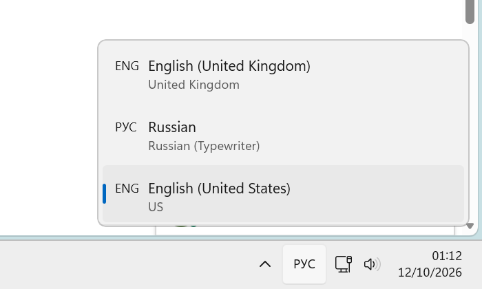
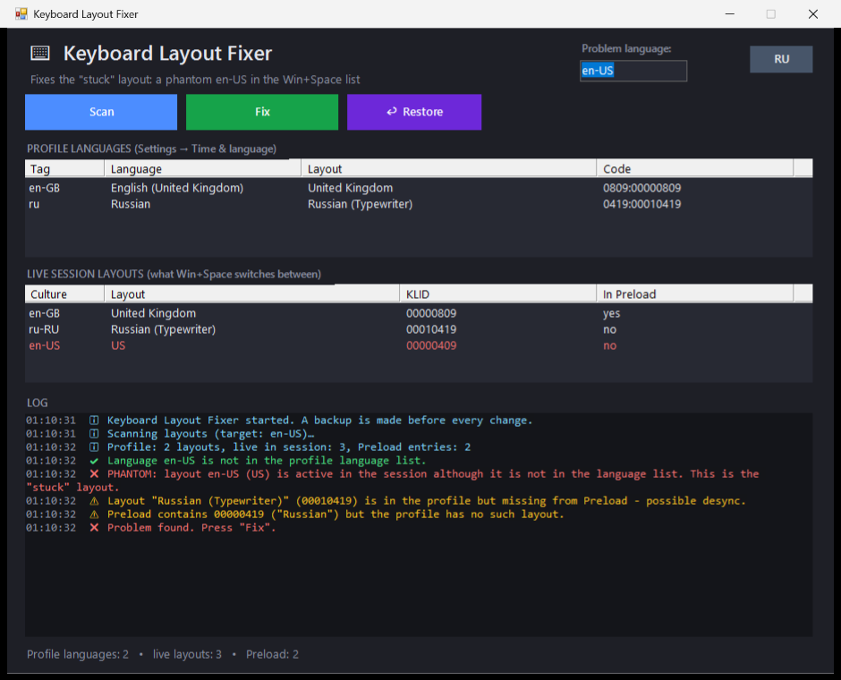
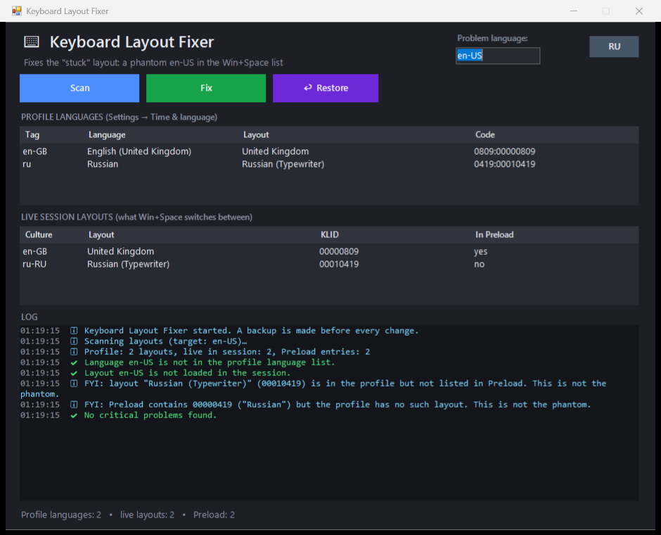
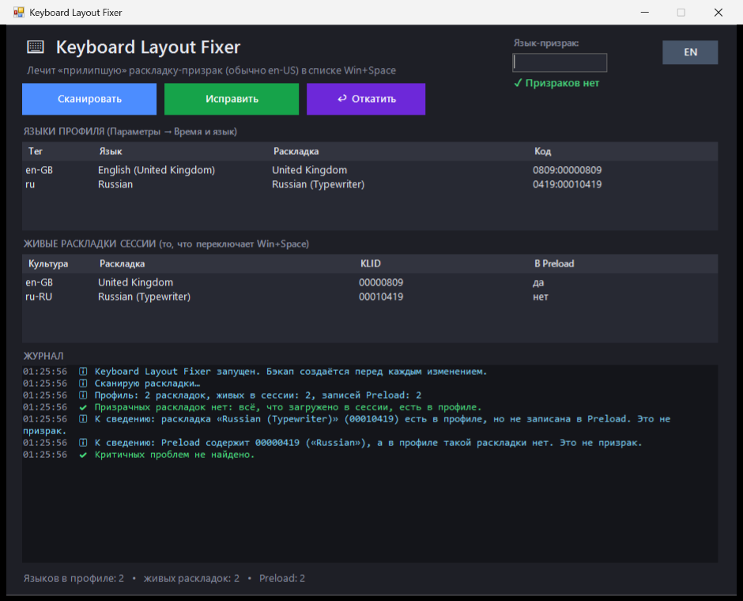

# Keyboard Layout Fixer

A small PowerShell + WinForms tool that removes the **phantom "stuck" keyboard layout** (typically `en-US`) that shows up in the Windows 10/11 language bar and in the **Win+Space** switcher, even though it isn't in Settings and can't be removed there.

*Русская версия — ниже.*



## Why it happens

Windows keeps more than one list of keyboard layouts, and they can disagree:

| Where | What | Who reads it |
|---|---|---|
| User language list (`Get-WinUserLanguageList`) | Languages/layouts in your profile | Settings app |
| Live session layouts (`GetKeyboardLayoutList`) | What is loaded right now | Win+Space, language bar |
| `HKCU\Keyboard Layout\Preload` | Layouts loaded at sign-in | Logon / input subsystem |

A layout that is loaded in the session but missing from the profile is a *phantom*: you can see it in Win+Space, but there is nothing in Settings to remove.

## What the tool does

- **Scan** — shows all three lists, flags the phantom in red (any language, not just en-US) and shows it in the header, or a green *No phantom layouts* when the session is clean.
- **Fix** — backs up your language list, temporarily adds the detected phantom language (usually `en-US`, but any language works) so Windows turns the phantom into a real entry, removes it, verifies the result (retrying if Windows re-adds an empty entry).
- **Restore** — puts the language list back from the last backup (`backups\*.json`).
- **RU / EN** — switches the interface language (default follows your Windows UI language).

It never removes your only language, and it only touches the **current user's** language list. It is the scripted version of this well-known workaround:

```powershell
$l = Get-WinUserLanguageList
$l.Add("en-US");  Set-WinUserLanguageList $l -Force      # make the phantom real
$l.Remove(($l | Where-Object LanguageTag -like 'en-US')) # ...then remove it
Set-WinUserLanguageList $l -Force
```

**Before** — the scan finds en-US loaded in the session but missing from the profile:



**After** — a clean session:



## Download

Get a ready-made program from the [Releases page](https://github.com/loglux/KeyboardLayoutFixer/releases/latest) (Windows 10/11, 64-bit, no admin rights needed). Same window and same fix as the script, but no PowerShell involved:

| File | Size | Needs |
|---|---|---|
| `KeyboardLayoutFixer-full.zip` | ~58 MB | nothing, runs anywhere (EXE + `lang` folder) |
| `KeyboardLayoutFixer-light.zip` | ~0.1 MB | [.NET 8 Desktop Runtime](https://dotnet.microsoft.com/download/dotnet/8.0) (Windows offers to install it on first launch) (EXE + `lang` folder) |
| `KeyboardLayoutFixer-languages.zip` | few KB | only the `lang` folder: `ru.json` and the blank `template.json` for your own language |

The EXE itself is English only; every other language, Russian included, is a file in the `lang` folder next to it (see [Translations](#translations)). Keep the folder next to the EXE to get the Russian interface.

The EXE is not code-signed yet, so Windows SmartScreen may warn about an unknown publisher: click **More info → Run anyway**. The source is in [`native/`](native/), build it with `dotnet build -c Release`. Backups are stored in `%LOCALAPPDATA%\KeyboardLayoutFixer\backups`. It also has a console mode: `--scan`, `--fix`, `--restore`, `--lang ru|en`.

## Usage (PowerShell script)

1. Download `KeyboardFix.ps1` and `KeyboardFix.bat` (and the `lang` folder for languages other than English) into the same folder.
2. Double-click `KeyboardFix.bat` (or run `powershell -STA -File KeyboardFix.ps1`).
3. Press **Scan**; if you see a red row, press **Fix**.
4. If the layout is still in the Win+Space list, sign out and back in — layouts already loaded into a session can survive until the next logon.

Command-line options:

```powershell
.\KeyboardFix.ps1 -Lang en            # force UI language (ru | en)
.\KeyboardFix.ps1 -NoGui              # read-only diagnostics in the console
.\KeyboardFix.ps1 -Fix               # console mode: scan, back up, fix detected phantoms, scan again
.\KeyboardFix.ps1 -Fix -Tag de-DE     # ...or force a specific language
.\KeyboardFix.ps1 -Screenshot out.png # scan and save a PNG of the window (used for docs)
```

Requirements: Windows 10/11, Windows PowerShell 5.1 (the script relaunches itself from PowerShell 7, because there the language-list objects arrive deserialized, without `Add`/`Remove`). No admin rights needed.

> The scan may also print an *FYI* when a profile layout isn't listed in `Preload` (for example Russian *Typewriter* `00010419` vs `00000419`). That is not the phantom; the tool only reports it and never touches `Preload`.

## Русская версия

Небольшая утилита на PowerShell + WinForms, которая убирает «прилипшую» раскладку-призрак (обычно `en-US`): она есть в Win+Space и в языковой панели, но её нет в «Параметрах», и удалить её оттуда нельзя.

Утилита показывает три списка (профиль, живая сессия, `Preload`), подсвечивает призрак красным и лечит его приёмом «добавить язык → применить → удалить → применить». Перед правкой делается резервная копия, кнопка **Откатить** возвращает её. Единственный язык не удаляется. Интерфейс переключается RU/EN.

**Готовая программа:** на странице [Releases](https://github.com/loglux/KeyboardLayoutFixer/releases/latest) есть архивы без PowerShell: `KeyboardLayoutFixer-full.zip` (58 МБ, ничего не требует) и `KeyboardLayoutFixer-light.zip` (0,1 МБ, нужен .NET 8 Desktop Runtime), в каждом EXE и папка `lang`. Сам EXE только на английском; русский и любой другой язык — это файл в папке `lang` рядом с ним. `KeyboardLayoutFixer-languages.zip` содержит только эту папку: `ru.json` и пустой шаблон `template.json`. Подписи у EXE пока нет, поэтому SmartScreen может предупредить: «Подробнее → Выполнить в любом случае». Исходники в [`native/`](native/).

Запуск скрипта: положите `KeyboardFix.ps1` и `KeyboardFix.bat` в одну папку и запустите `KeyboardFix.bat` → **Сканировать** → **Исправить**. Если раскладка осталась в списке, перезайдите в систему.



## Translations

English is built in; Russian ships as `lang/ru.json`. To add another language, copy `lang/template.json` to `lang/xx.json` (`xx` = language code, e.g. `de.json`), set `"_name"` to the language's own name and fill in the values. Empty values fall back to English, so a partial translation works. Put the `lang` folder next to `KeyboardFix.ps1` or next to the EXE, or send the file as a pull request. `--lang xx` (EXE) / `-Lang xx` (script) selects it; by default the Windows UI language is used.

## Перевод

Английский встроен, русский лежит в `lang/ru.json`. Чтобы добавить язык, скопируйте `lang/template.json` в `lang/xx.json` (`xx` — код языка, например `de.json`), впишите в `"_name"` название языка на нём самом и заполните значения. Пустые значения заменяются английскими, поэтому неполный перевод тоже работает. Папку `lang` положите рядом со скриптом или EXE либо пришлите файл pull request'ом.

## License

[MIT](LICENSE)
